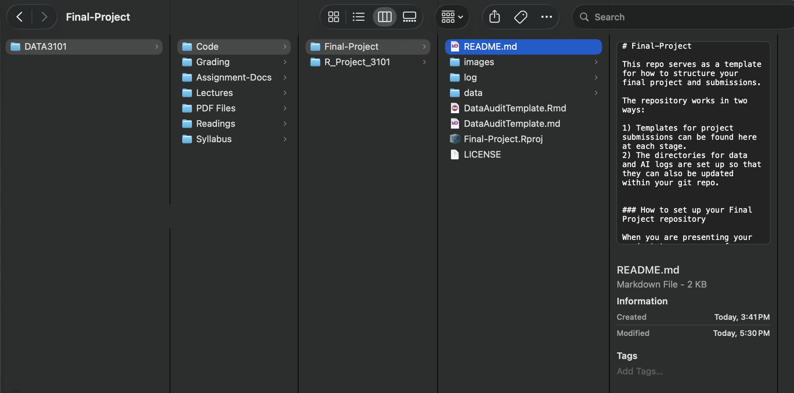

# Final-Project

This repo serves as a template for how to structure your final project and submissions. 

The repository works in two ways:

1) Templates for project submissions can be found here at each stage.
2) The directories for data and AI logs are set up so that they can also be updated within your git repo.

### How to set up your Final Project repository

When you are presenting your project to your peers for testing the code, or potentially using it as a reference for future work / school opportunities, you probably won't want others to have to sift through all the other practice code you've been developing through this term!

Because of that, this repository has been set up as a template. That means that you are going to be creating a new repository for your final project within the DATA3101 organization. Here's the instructions:

1) Navigate to the Final-Project repository in the Data3101 Organization
2) To the right of the "Code" button above the file list, there's a new button titled `Use this template`. This will take you to a new window.
3) Select 'DATA3101-2026` as the repository owner
4) Type in your repository name with the format as *Final-Project-FirstName-LastName* (replacing the names with your name).
5) Choose repository visibility. If you want this to be moved to your personal GitHub profile later (making sure that you control how it exists past the class end date), make sure it is visible as `public` so that you can bring it out of our class' organization page.
6) Click `Create repository from template`

Voila! You now have created a second repository in this class.

Later on, you will have to clone your new repo to your local computer, so that you can update your work and push it back up to GitHub. As a refresher, I'll add in the cloning instructions into this README. But before we walk through that, let's make sure your computer will be set up so that it's really clear for you what you are working on each time you open R.

### Reducing git commit confusion

Here's a couple tips for how to not confuse future commits between assignments, live coding sessions, and your final project:

- When you clone your new repo to your computer, DO NOT save it within the `.RProj` folder you are using for your class repo.
- Instead, clone it to the parent directory above the repo. Here's a picture to show what I've done in my example.

